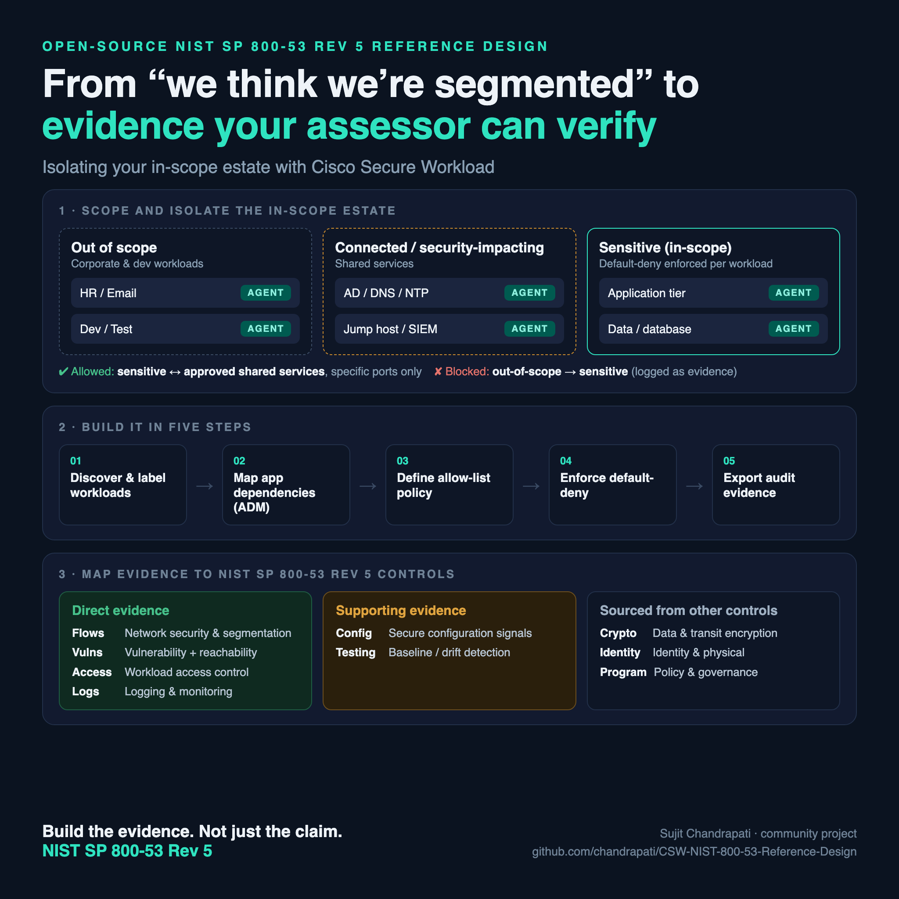
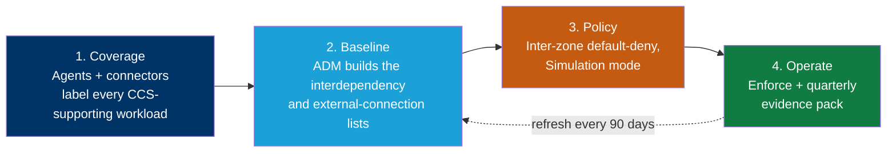

# Cisco Secure Workload — TSA Rail Cybersecurity Reference Design





> A step-by-step blueprint for building **Cisco Secure Workload (CSW)** so a freight or passenger railroad Owner/Operator can segment the IT estate around its **Critical Cyber Systems** and produce the **machine-generated evidence** a TSA inspector expects under **Security Directive 1580/82-2022-01E, *Rail Cybersecurity Mitigation Actions and Testing*** — zone enforcement, interdependency and external-connection lists, baseline-deviation detection, KEV-prioritized vulnerability exposure, and east-west / north-south traffic records.

CSW does **not** certify compliance with any TSA Security Directive. **TSA inspects against your TSA-approved Cybersecurity Implementation Plan**, not against the SD text and not against a vendor document. CSW turns workload communication, process activity, and inventory into **evidence** that maps to the measures in that plan.

---

## Why this directive fits CSW unusually well

Most frameworks require you to argue that network telemetry is relevant evidence. **This one names it.**

Section **IV.C.2.e** lists, among the records TSA inspectors may demand:

> iii. **"East-West Traffic"** of Operational Technology systems/sites/environments within the scope of this Security Directive's requirements; and
> iv. **"North-South Traffic"** between Information and Operational Technology systems, and the perimeter boundaries between them.

Section **VII** then defines both terms — east-west as "the lateral movement of network traffic within a trust zone or local area network," north-south as traffic "through a perimeter boundary into another trust level." And Section **III.B** makes network segmentation the *first* substantive requirement, with prescriptive sub-requirements for interdependency lists, external-connection lists, and logical zone boundaries.

You are not translating CSW output into the regulator's vocabulary. The regulator is already using it.

> ### Read this before customer use
>
> **Confirm the active revision letter.** This SD series is renewed annually and the letter advances (01, 01A … 01E). Revision **E** is effective **May 3, 2026 through May 2, 2027**; the renewal memo states there are no substantive changes from 01D, but that will not hold indefinitely. TSA intends to codify these requirements through rulemaking.
>
> **The SD text is not SSI, but your submissions are.** TSA determined this directive is not Sensitive Security Information, so the requirements can be discussed openly. **Everything you submit to TSA under it is SSI** under 49 CFR part 1520. Once a CSW export lands in a plan or report, handle it accordingly.
>
> **Delegation does not transfer responsibility.** If a Managed Security Service Provider or Authorized Representative operates controls on the operator's behalf, the **Owner/Operator retains sole responsibility**, and both parties are liable for the representative's non-compliance.

---

## What's in this repo

| Document | For | Use it to |
|---|---|---|
| **[Reference Design](CSW-TSA-Rail-Reference-Design.md)** | SE / platform / security engineering | Build CSW end-to-end: zone architecture, labels, ADM, Section III.B policy, provision-by-provision evidence |
| **[IT/OT Scope Boundary](CSW-TSA-Rail-Reference-Design.md#12-the-itot-scope-boundary--read-this-before-claiming-anything)** | Anyone scoping the engagement | Know exactly what CSW reaches and what belongs to the OT stack — **read this first** |
| **[Evidence Boundary](CSW-TSA-Rail-Reference-Design.md#7-evidence-boundary--what-you-must-supply-outside-csw)** | Compliance, accountable officer, inspector | Know what CSW evidences and what must come from elsewhere |
| **[Evidence Checklist](docs/evidence-checklist.md)** | Evidence owner | A printable "what to export, from where, how often" worklist keyed to SD provisions |
| **[POV / Workshop Plan](docs/pov-plan.md)** | SE + operator | Run a scoped 45-day proof-of-value on one site or region |
| **[TSA Inspector Response Guide](CSW-TSA-Rail-Reference-Design.md#8-tsa-inspector-response-guide)** | Anyone facing an inspection | Match each likely request to the exact artifact — including the ones CSW can't answer |

Also available as a [Technical Runbook](https://github.com/chandrapati/CSW-Compliance-Reference-Designs/blob/main/TSA-Rail/CSW-TSA-Rail-Technical-Runbook.md) in the umbrella repo, with PDF, DOCX, and HTML exports.

---

## How CSW produces evidence — the big picture



Each phase produces a specific, exportable artifact. The **[Reference Design](CSW-TSA-Rail-Reference-Design.md)** maps every artifact to an SD provision.

---

## The IT/OT boundary — what CSW actually reaches

**Read this before scoping anything.** CSW is a workload protection platform for **IT estate**. It does not enforce policy on wayside units, signal controllers, locomotive onboard PTC hardware, or PLCs, and it does not inspect rail or OT protocols.

| In CSW's reach (IT-side) | Out of CSW's reach (OT device layer) |
|---|---|
| **PTC Back Office Server** and supporting hosts | Locomotive onboard PTC components |
| Dispatch / computer-aided dispatch (CAD) servers | Wayside interface units, signal controllers |
| Signaling-support and interlocking-support servers | Grade-crossing warning devices |
| Historians, reporting and analytics databases | Track circuits, switch machines |
| Engineering and maintenance workstations | Traction power field devices |
| Train management, movement planning, crew scheduling | Programmable logic controllers |
| Vendor and MSSP remote-access hosts | — |
| Identity, PKI, logging, and patch infrastructure | — |

**The PTC back office is the point worth making.** Section III.A.2 makes PTC systems a **mandatory** Critical Cyber System, and the back office is a server workload — squarely in CSW's reach. A railroad can produce genuine workload-level evidence for its single most inspection-sensitive system.

Your OT-aware stack (Cisco Cyber Vision, Claroty, Nozomi, Dragos) and IT/OT boundary firewalls remain the controlling artifacts below the boundary. Claiming otherwise to an inspector costs credibility you need elsewhere.

---

## The zone model

Section III.B.1.c requires you to describe how systems are "organized into logical zones based on criticality, consequence, and operational necessity." That sentence is a specification for a scope tree.

```
Root Scope
└── Rail-Critical-Cyber-Systems
    ├── OT-Facing-IT                      (reaches into the signaling / PTC domain)
    │   ├── PTC-Back-Office               (mandatory CCS — III.A.2)
    │   ├── Dispatch-and-CAD
    │   ├── Signaling-Support
    │   ├── Historians
    │   └── Engineering-Workstations
    ├── CCS-Supporting-IT                 (CCS, but not OT-facing)
    │   ├── Train-Mgmt-and-Planning       (business critical functions)
    │   ├── Identity-and-PKI
    │   ├── Logging-and-Monitoring
    │   └── Patch-Repositories
    ├── Privileged-Access-Paths           (III.C local and remote access)
    ├── Corporate-IT                      (default-deny source)
    └── External
        ├── Internet-Edge
        └── Vendor-and-MSSP-Access        (Authorized Representatives / MSSPs)
```

**`Train-Mgmt-and-Planning` is where under-scoping hides.** The SD defines a Critical Cyber System as anything whose compromise "could result in operational disruption" and explicitly **includes business services**. Crew scheduling and movement planning can be Critical Cyber Systems even though they are not signaling systems.

Full inventory filters, the labeling strategy (`ccs_id`, `ccs_function`, `zone`, `ot_facing`, `ptc`, `managed_by`), and the enforced policy set are in the **[Reference Design §3–4](CSW-TSA-Rail-Reference-Design.md#3-scope-architecture-and-labeling)**.

---

## Coverage snapshot

CSW provides **🟢 Direct** evidence for **16** SD provisions, **🟠 Supporting** input for **16**, and marks **⚪ Evidence Required** *(supplied outside CSW)* for **8**.

**Coverage key**

- 🟢 **Direct** — CSW produces the **primary evidence** artifact for the provision.
- 🟠 **Supporting** — CSW produces an **input that feeds or complements** another provision's evidence.
- ⚪ **Evidence Required** *(supplied outside CSW)* — CSW produces **nothing** here. The provision is **in scope for compliance but out of scope for CSW**; the operator supplies the evidence through **another control, tool, or process**. This marks a **boundary, not a gap or a failure.**

> Coverage describes what evidence CSW produces — **not** that a provision is satisfied, and ⚪ never means a provision is unsupported.

### Where CSW is the primary evidence source

| Provision | Requirement | What CSW gives the inspector |
|---|---|---|
| **III.B.1.a** | IT/OT **interdependencies** | ADM dependency graph derived from observed traffic — the SD's own definition of interdependency |
| **III.B.1.b** | **All external connections** | Enumerated from flow data, including the ones missing from the documented architecture |
| **III.B.1.c** | **Zone boundaries** by criticality and consequence | The scope tree *is* the zone model; labels make criticality queryable |
| **III.B.1.d** | Cross-boundary transit only for **validated purposes** | Allowlist where every rule carries a business justification |
| **III.B.2.a** | **Prevent** unauthorized inter-zone communication | Enforced deny plus the Denied Connections log proving it operates |
| **III.D.2.b** | Audit OT-to-external communications **deviating from baseline** | ADM baseline plus deviation detection — the SD's wording describes the artifact |
| **III.D.3.a** | **Continuous collection and analysis** | Continuous flow, process, and policy-violation telemetry |
| **III.D.4** | **Isolate** ICS when an IT incident threatens OT | Pre-staged isolation workspace plus the dated test record |
| **III.E.2.b** | Prioritize **CISA KEV** vulnerabilities | KEV-filtered CVE inventory intersected with CCS labels |
| **III.E.3** | Mitigations where patching would degrade operations | Compensating policy restricting the vulnerable port, with the register |
| **III.F.2.b** | Architecture review: **traffic verification, log review, interconnectivity** | All three input artifacts; the review conclusion stays human |
| **IV.C.2.a / .c / .e.i** | Asset inventory, network diagrams, log files | Inventory with packages, dated ADM map, flow and process logs |
| **IV.C.2.e.iii** | **"East-West Traffic"** | Intra-zone flow records — named in the SD, native CSW output |
| **IV.C.2.e.iv** | **"North-South Traffic"** | Cross-zone flow records at the boundary |

The full provision-by-provision table, including the 🟠 Supporting rows, is in **[Reference Design §2](CSW-TSA-Rail-Reference-Design.md#2-sd-provision-mapping)**.

---

## What CSW does **not** cover

This is the section that makes the rest of the mapping credible. Full detail in **[Reference Design §7](CSW-TSA-Rail-Reference-Design.md#7-evidence-boundary--what-you-must-supply-outside-csw)**.

| Provision | Topic | Who evidences it |
|---|---|---|
| **III.C.1** | Memorized-secret authenticator reset policy | Identity provider and OS policy, per NIST SP 800-63 |
| **III.C.2** | **MFA** and OT compensating controls | Cisco ISE, Duo, or equivalent |
| **III.C.4** | Shared-account management | Account management / privileged-access tooling |
| **III.C.5** | Domain trust relationship review | Directory services |
| **III.C.6** | PTC locomotive **physical security** alternative | Physical security programme under 49 CFR 232.105(h), 236.3, 236.553 |
| **III.D.1.a** | Malicious email defence | Email security gateway |
| **III.D.1.c** | Malicious web domain control | DNS / web security — Cisco Umbrella or equivalent |
| **IV.C.2.e.ii** | **Packet capture** up to 24 hours | Capture appliance or OT sensor — CSW records flow metadata, not payloads |

Also entirely outside CSW: the Cybersecurity Implementation Plan and its approval, the Cybersecurity Assessment Plan and annual report, the Cybersecurity Incident Response Plan, CISA incident reporting, the Cybersecurity Coordinator designation, personnel and training programmes, and the **OT device layer in its entirety**.

### Two boundaries that are routinely misread

**1. Encryption.** Section III.B.2.b permits IT/OT traversal only where "the content is encrypted or, if not technologically feasible, otherwise secured and protected." **CSW does not encrypt application data.** It contributes *detection* — the `Plaintext-Crossing-Zones` filter identifies, with flow-level evidence, which cross-zone paths still run cleartext. Useful input to the III.B.2.b narrative; not the provision. Where encryption is infeasible on legacy rail protocols, a tightly scoped, enforced, logged path is a credible part of the "otherwise secured" argument — but that argument is the operator's to make in the plan.

**2. Evidence must be plan-relative.** TSA inspects against the **approved Cybersecurity Implementation Plan**. An evidence pack mapped to SD provisions but not to your plan's measures will not land. Map every artifact to a plan measure, and remember that a CSW policy change altering an approved segmentation measure can trigger a **Section VI plan amendment** — permanent change means 45+ days, filed within 50 days of taking effect.

---

## Start here

1. **Confirm the active revision letter** and obtain the operator's **TSA-approved Cybersecurity Implementation Plan** — that plan, not the SD, is the inspection baseline.
2. **Settle the IT/OT scope boundary** (see above and **[§1.2](CSW-TSA-Rail-Reference-Design.md#12-the-itot-scope-boundary--read-this-before-claiming-anything)**). Over-claiming here is the fastest way to lose an inspector's confidence.
3. Read the **[Reference Design](CSW-TSA-Rail-Reference-Design.md)** — zone architecture, labels, and the Section III.B policy set.
4. Reconcile the **Critical Cyber System register**, including PTC per III.A.2 and the business services that cause operational disruption.
5. Run the **[POV plan](docs/pov-plan.md)** on one site or region.
6. Track exports with the **[Evidence Checklist](docs/evidence-checklist.md)**.
7. Hand the operator the **[evidence-boundary statement](CSW-TSA-Rail-Reference-Design.md#7-evidence-boundary--what-you-must-supply-outside-csw)** alongside the evidence — so nobody assumes CSW covered MFA, encryption, packet capture, or the OT device layer.

---

## References & official sources

Authoritative source(s) for the **TSA Rail Security Directive**. Always validate provision references and the active revision letter against the current official text before customer use — this series is renewed annually.

- [TSA Security Directives and Emergency Amendments](https://www.tsa.gov/sd-and-ea) — authoritative index, including the current revision letter
- [SD 1580/82-2022-01E and transmittal memo](https://www.tsa.gov/sites/default/files/signed_security_directive_1580_82-2022-01e_and_transmittal_memo_508c.pdf)
- [SD 1582-21-01 series](https://www.tsa.gov/sites/default/files/security_directive_1582-21-01c_and_memo_508c.pdf) — public transportation and passenger railroad
- [CISA Known Exploited Vulnerabilities Catalog](https://www.cisa.gov/known-exploited-vulnerabilities-catalog) — referenced by Section III.E.2.b
- [NIST SP 800-63 Digital Identity Guidelines](https://csrc.nist.gov/publications/detail/sp/800-63/3/final) — referenced by Section III.C.1
- Cisco Secure Workload — [product documentation](https://www.cisco.com/c/en/us/support/security/secure-workload/series.html)

---

## Disclaimer

This repository is for informational and planning purposes. It is **not** legal, regulatory, audit, or certification advice, and it is **not** a finding of compliance with any TSA Security Directive. TSA Security Directives are issued and revised by the Transportation Security Administration under its regulatory authority; designated Owner/Operators are required to comply, and **TSA inspects against the Owner/Operator's TSA-approved Cybersecurity Implementation Plan**, not against a vendor document. Validate all provision references and the active revision letter against the current official text. Designation as a covered Owner/Operator is a TSA determination. CSW does not enforce policy on OT devices and is not an OT-protocol inspection or architecture-review tool. Replace any bracketed fields before customer delivery, and obtain subject-matter-expert review for both regulatory accuracy and current Cisco product capability before relying on this in a formal compliance engagement.

---

*Part of the Cisco Secure Workload compliance reference-design series. Umbrella index: [CSW-Compliance-Mapping](https://github.com/chandrapati/CSW-Compliance-Reference-Designs).*
