# TSA Rail SD 1580/82-2022-01E — CSW POV / Workshop Plan

A ~45-day proof-of-value that stands up CSW evidence on **one** site or region. The goal is a repeatable evidence pack and asset-owner confidence — not an estate-wide rollout.

> Scope one subdivision, region, or facility. Rail estates are geographically distributed and inspections are often site-scoped, so a single-site POV maps naturally onto how the operator is actually examined.

```mermaid
gantt
    dateFormat  X
    axisFormat  Day %s
    section Coverage
    Instrument + label           :a1, 0, 10
    section Baseline
    ADM observation (>=2 wks)     :a2, 10, 18
    Asset-owner signoff           :a3, 24, 4
    section Policy
    Author + Simulation           :a4, 29, 10
    section Operate
    Enforce + evidence pack       :a5, 39, 6
```

> **Simulation note.** The 45-day outline above gets you to enforcement on the *absolute deny* rules. For OT-facing tiers plan **30 days of simulation** before full allowlist enforcement — rail traffic is seasonal and schedule-driven, and a two-week window will miss patterns.

## Prerequisites

- The **TSA-approved Cybersecurity Implementation Plan**, and the **active SD revision letter**. The plan is the inspection baseline; the readout must be written to its measures, not to the SD text alone.
- The **Critical Cyber System register**, including PTC systems (mandatory per III.A.2) and any **business services** whose loss causes operational disruption.
- A settled **IT/OT scope boundary** (§1.2 of the Reference Design). Agree in writing what belongs to CSW and what belongs to the OT-aware stack before day 1.
- Documented OT network ranges, so `ot_facing` can be derived from observed flows.
- Names of any **MSSP or Authorized Representative** with access, for `managed_by` labelling.
- Last inspection findings, if available, to align exports to what was actually requested.
- Change-management contact for the enforcement step, and awareness of the **Section VI amendment** trigger (permanent change = 45+ days, filed within 50 days).

## Day-by-day

### Days 1–10 — Coverage
- Deploy agents to the chosen site's OT-facing IT tier, the PTC back office, dispatch, historians, and jump hosts; add cloud connectors for agentless inventory.
- Apply labels — `ccs_id`, `ccs_function`, `zone`, `ot_facing`, `ptc`, `managed_by`, `site` — and build the scope sub-tree **to match the approved plan's zone model**.
- Record a **cannot-instrument register**; in rail this commonly includes appliance-form signaling-support components, and the register is itself evidence.
- Run the under-scoping check on business services (crew scheduling, movement planning, consist and waybill management).
- **Milestone:** full coverage of the site's CCS-supporting IT (or justified exceptions) + inventory export.

### Days 11–28 — Baseline
- Run ADM for a full operating cycle (≥ 2 weeks; extend across a maintenance window).
- Produce the two Section III.B.1 lists directly from observed data: **interdependencies** (III.B.1.a) and **external connections** (III.B.1.b).
- Run `Plaintext-Crossing-Zones` early — III.B.2.b findings need lead time with application and signaling-support teams.
- Review discovered clusters with asset owners; flag shadow IT, vendor egress, and scope creep.
- **Milestone:** asset owners sign the cluster-to-system mapping; ADM map, interdependency list, and external-connection list exported.

### Days 29–45 — Policy → Operate
- Import ADM flows; set **inter-zone default-deny**; make each allow explicit **with a business or operational justification** (III.B.1.d).
- Run **Simulation** — every would-deny becomes a change ticket, not a service interruption.
- Enforce the absolute deny rules first (§4.1), particularly `Corporate-IT → OT-Facing-IT` and `Vendor-and-MSSP-Access → PTC-Back-Office`.
- Build the **pre-staged isolation workspace** for III.D.4 and test it during a planned maintenance window. Record the test and the time it took.
- Capture a negative test in Denied Connections.
- **Milestone:** enforcement live on absolute denies + first evidence pack assembled + isolation test recorded.

## Exit criteria

- [ ] Full coverage of the site's CCS-supporting IT (or documented exceptions)
- [ ] Scope tree reconciled to the approved plan's zone model (III.B.1.c)
- [ ] Interdependency and external-connection lists produced from observed data (III.B.1.a, III.B.1.b)
- [ ] Inter-zone default-deny enforced with a logged denied connection (III.B.2.a)
- [ ] **East-west and north-south traffic records** demonstrated on request (IV.C.2.e.iii–iv)
- [ ] Baseline-deviation detection demonstrated (III.D.2.b)
- [ ] Pre-staged isolation workspace built **and tested**, with the record filed (III.D.4)
- [ ] KEV exposure report intersected with CCS labels (III.E.2.b)
- [ ] Plaintext-crossing-zones report produced and routed to the encryption owner
- [ ] Simulation report + exception register filed
- [ ] An evidence binder the inspector can consume without a live walkthrough

## Deliverables

- Evidence pack per the [Evidence Checklist](evidence-checklist.md)
- Policy + simulation exports, the exception register, and the isolation test record
- A short readout mapping each export to **a measure in the approved Cybersecurity Implementation Plan** — and secondarily to the SD provision
- An explicit **evidence-boundary statement** (§7) naming what the operator must evidence outside CSW, including the OT device layer

> Include the boundary statement in the readout. Operators and inspectors trust the mapping more when it marks its own limits, and it prevents anyone assuming CSW has covered MFA, encryption, packet capture, or the OT devices themselves.

*Tune cadence to the operator's inspection and assessment cycle. Validate evidence sufficiency against the approved plan. CSW evidence is an input to compliance, not a finding of compliance, and no product is "TSA certified."*
